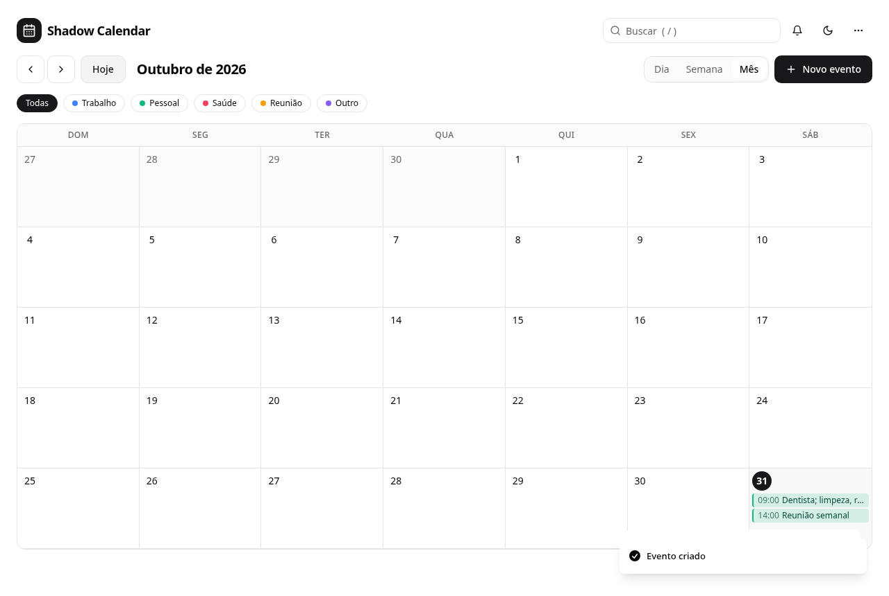
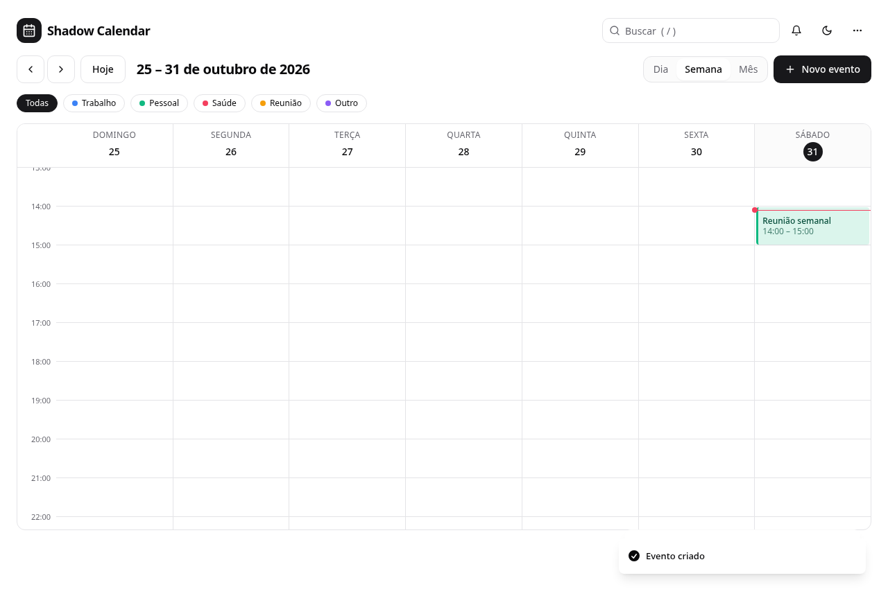
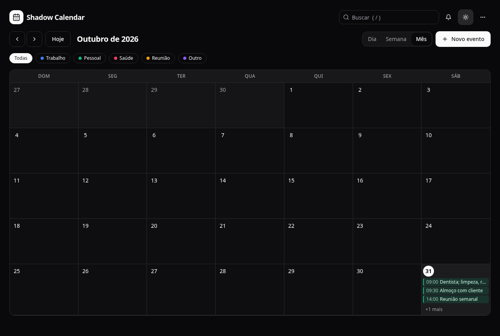
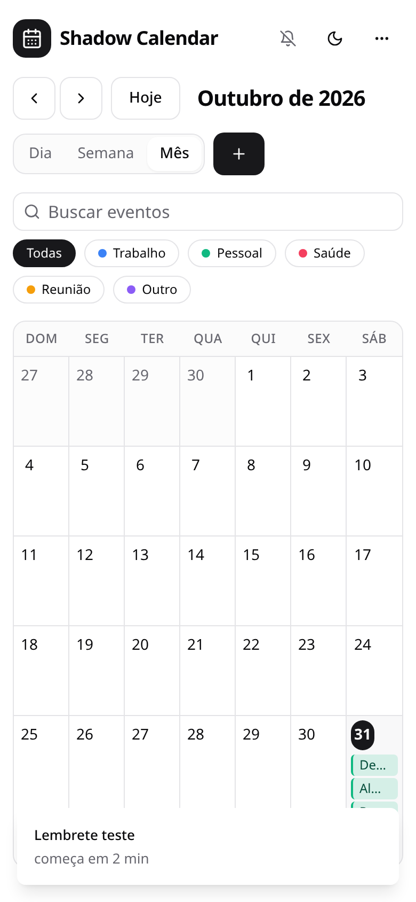

# Shadow Calendar

Agenda minimalista no navegador: visões de **dia, semana e mês**, eventos com duração e **recorrência**, **lembretes**,
busca, categorias, tema claro/escuro e exportação para `.ics` (Google Agenda, Apple Calendário, Outlook).

**Demo:** https://shadow-calendar.vercel.app

| Mês | Semana |
| --- | --- |
|  |  |

| Tema escuro | Celular |
| --- | --- |
|  |  |

## Recursos

- **Três visões**: mês (com "+N mais"), semana e dia em grade de horas, com eventos posicionados pela duração,
  sobreposições lado a lado e a linha de "agora".
- **Eventos completos**: título, descrição, data, horário de início e fim, categoria e status de concluído.
- **Recorrência**: diária, semanal ou mensal (um evento no dia 31 cai no último dia dos meses mais curtos).
- **Lembretes** (na hora, 5/15/30 min, 1 h ou 1 dia antes): aviso na tela e, se você permitir, notificação do
  navegador. Funcionam enquanto o app estiver aberto.
- **Busca e filtro por categoria**, e atalhos de teclado: `N` novo · `T` hoje · `D`/`W`/`M` visões · `←`/`→` navegar ·
  `/` buscar.
- **Excluir com "Desfazer"**, importar/exportar backup (`.json`) e exportar a agenda em **`.ics`** (inclui recorrência e
  lembretes).
- **Seus dados ficam no seu navegador** (localStorage): não há conta nem servidor.
- Tema claro/escuro (segue o sistema), layout responsivo, navegação por teclado e rótulos de acessibilidade.

## Tecnologias

React 18 · TypeScript (strict) · Vite · Tailwind CSS · shadcn/ui (Radix) · date-fns · Vitest

## Como executar

Requer Node.js 20+.

```bash
npm install
npm run dev       # http://localhost:5173
```

| Script | O que faz |
| --- | --- |
| `npm run dev` | servidor de desenvolvimento |
| `npm run build` | checagem de tipos + build de produção |
| `npm run preview` | serve o build localmente |
| `npm run lint` | ESLint |
| `npm test` | testes unitários (Vitest) |

## Estrutura

```
src/
├── lib/
│   ├── events.ts        modelo, recorrência, layout da grade, backup, exportação .ics
│   ├── events.test.ts   testes da lógica (20 casos)
│   └── format.ts        títulos de período em português
├── contexts/            estado (EventProvider) e hook useEvents
├── hooks/               lembretes, atalhos de teclado, relógio
└── components/
    ├── calendar/        toolbar, visão mensal, grade de horas (semana/dia), formulário
    └── ui/              componentes shadcn usados pelo app
```

A lógica de datas fica em `src/lib/events.ts`, sem React, para ser testável: `expandEvents` gera as ocorrências de
eventos recorrentes num intervalo, `layoutDay` calcula posição e colunas na grade e `toICS` produz o arquivo de
exportação.

## Deploy

Site estático. Na Vercel/Netlify: build `npm run build`, saída `dist`.

## Sobre o projeto

O Shadow Calendar nasceu como um projeto de estudo. Esta versão remove o login simulado (que não protegia nada e perdia
os usuários ao recarregar a página), deixa de inserir eventos fictícios, traduz a interface, corrige a visão do dia
(que misturava eventos de todos os dias) e adiciona o que o README antigo prometia mas não existia: lembretes e
notificações. Eventos salvos pela versão antiga são migrados automaticamente.

## Limitações conhecidas

- Os lembretes só disparam com a aba aberta (não há servidor para notificar em segundo plano).
- Não há sincronização entre dispositivos; use exportar/importar backup.
- Eventos não atravessam a meia-noite pelo formulário (início e fim no mesmo dia).
